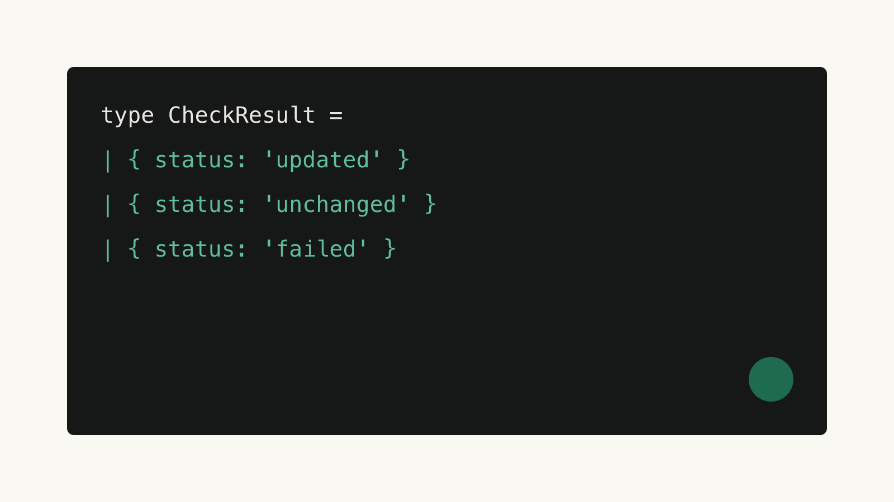

import demo from './writing-blocks/demo.mp4?url';
import poster from './writing-blocks/demo-poster.jpg?url';

## Figures

An image with alt text becomes a figure, and the alt text is its caption.[^1]



<Video src={demo} poster={poster} caption="A short demo plays silently while it is on screen, and never under reduced motion." />

## A shell session

```sh terminal
$ npm run check
US English check passed: 126 project text files.
- 0 errors
$ npm test
ℹ pass 11
```

## A diagram from text

```dot caption="The three outcomes of a check, drawn from a dot fence at build time."
digraph {
  rankdir = LR;
  check [label="check source", color="#141414"];
  check -> "updates found";
  check -> "no updates";
  check -> failed [color="#1f6b4f", fontcolor="#1f6b4f"];
  failed [label="check failed", color="#1f6b4f", fontcolor="#1f6b4f", style="rounded,dashed"];
  "updates found" -> report;
  "no updates" -> report;
  failed -> report;
}
```

## A conversation

<Transcript model="Claude" date="Oct 14, 2026">
  <Turn role="user">
    Review this function and tell me which of the three outcomes it cannot distinguish.

    `describe(result)` from the type sketch above.
  </Turn>
  <Turn role="model">
    It cannot distinguish `unchanged` from `failed` when the caller only checks whether the array is empty. Both produce an empty page, and the reader cannot tell a quiet day from a broken fetch.

    The fix is to carry the status through to the interface rather than collapsing it into an array length. Each of the three cases deserves its own sentence on the page.

    If the page must stay minimal, show the status only when it is not `updated`, so the common case stays clean and the two quiet cases become visible exactly when they matter.

    One more consideration is logging. Even when the interface shows nothing, the run should record which sources were checked and whether each check succeeded, so a later reader can audit a quiet day.

    Finally, make the failed case loud in the one place someone will look when things go wrong: the run log, with the reason string from the result.
  </Turn>
</Transcript>

## Math

Sorting costs $O(n \log n)$ in the general case, and the bound is tight:

$$
T(n) = 2T\left(\tfrac{n}{2}\right) + \Theta(n)
$$

[^1]: Footnotes render as a hairline list at the end of the article, with a return link.
